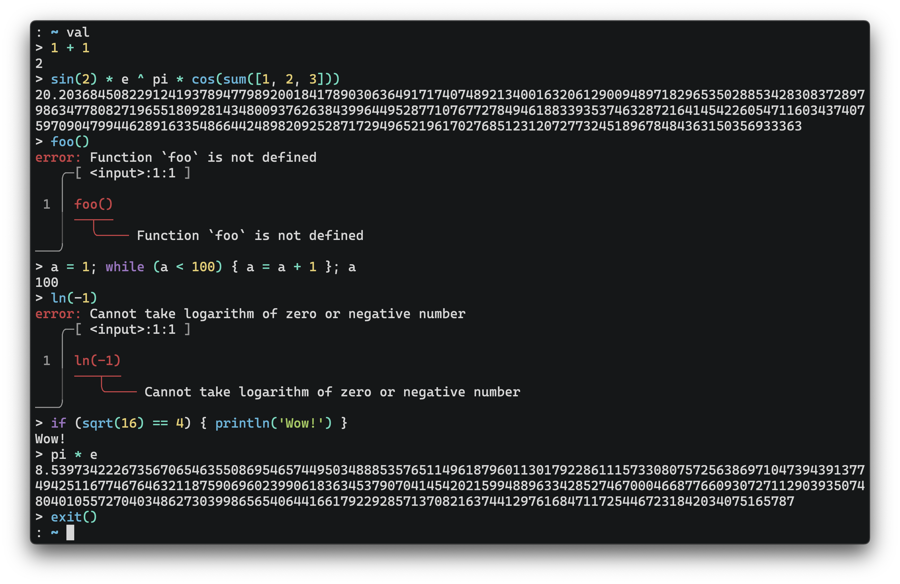

## val

[](https://github.com/terror/val/releases/latest)
[](https://crates.io/crates/val)
[](https://github.com/terror/val/actions/workflows/ci.yaml)
[](https://codecov.io/gh/terror/val)
[](https://docs.rs/val)
[](https://deps.rs/repo/github/terror/val)

**val** (e**val**) is a simple arbitrary precision calculator language built
on top of [**chumsky**](https://github.com/zesterer/chumsky) and
[**ariadne**](https://github.com/zesterer/ariadne).

[Website](https://val-one-phi.vercel.app/) ·
[Documentation](https://val-one-phi.vercel.app/documentation) ·
[Playground](https://val-one-phi.vercel.app/playground)



`val` supports exact arithmetic, configurable precision, functions, loops,
lists, and an interactive REPL.

## Installation

The easiest way to install it is by using
[cargo](https://doc.rust-lang.org/cargo/index.html), the Rust package manager:

```bash
cargo install val
```

See the [installation guide](docs/installation.md) for other package managers
and pre-built binaries.

## Usage

See the documentation for [command-line usage](docs/usage.md),
[the language](docs/language.md), [numbers and precision](docs/numbers.md),
[built-in functions and constants](docs/builtins.md), and
[the playground](docs/playground.md).

See [examples](examples) for complete programs and the [grammar](GRAMMAR.txt)
for the language syntax.

## Prior Art

[bc(1)](https://linux.die.net/man/1/bc) - An arbitrary precision calculator
language
